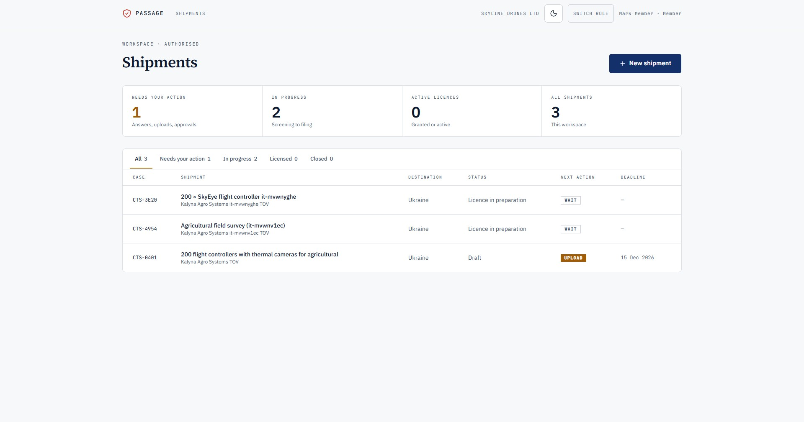
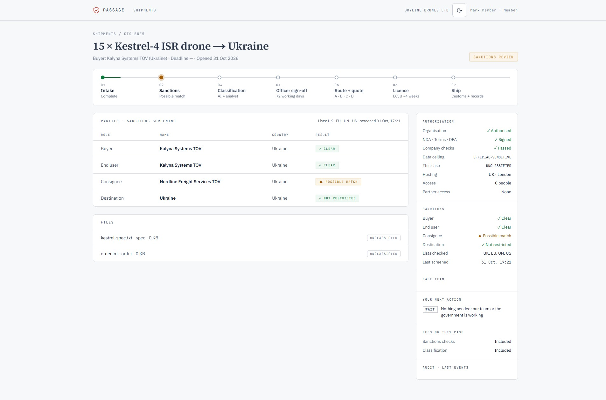
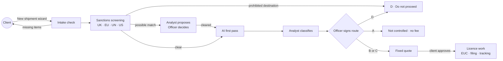

<h1 align="center">Passage</h1>

<p align="center"><b>Defence and dual-use startups win contracts. We make sure they can legally ship them.</b><br/>
Like clearing customs for general logistics: fast, compliant passage for defence-tech and dual-use goods.
AI suggests, an expert signs, and every step is on the record.</p>

<p align="center">
  <a href="https://passage-gamma.vercel.app">Live app</a> ·
  <a href="https://docs.google.com/presentation/d/1Nr070PjOOPk6eAdJUUW_KJInihI6l2jiOAQdU3cZkD8/edit?usp=sharing">Pitch deck</a> ·
  <a href="docs/build-plan.md">Product spec</a> ·
  <a href="docs/design/DESIGN.md">Design system</a>
</p>

Team 11 · The PROBLEM day · Supply chain and logistics track · London, 31 October 2026.

---

## The problem

Meet Sam (a composite built from real cases). He's CTO of a 12-engineer, seed-stage startup that builds AI sensors
to spot enemy drones, and he has just won a deal with a manufacturer in Kharkiv. Then he hits three walls:

1. **"Classify this product."** No control list clearly covers it. New EU dual-use entries arrived in November 2025,
   and drones like Octopus are redesigned every six weeks.
2. **"Your business has to be cleared for the Ukrainian buyer."** A £200m UK drone plant has been idle since
   February 2026, waiting on a Ukrainian permit.
3. **"Prove nobody in this chain touches Russia."** Investors flag compliance gaps in due diligence, and Western
   parts made in 2025 have turned up in Russian drones.

So for six weeks, Sam stops building and fills in forms himself.

### How big it is

| | |
|---|---|
| **~11k** | UK individual export licences a year (ECJU) |
| **~18.5k** | EU dual-use transactions under individual licences in 2024 (EU annual report) |
| **~68k** | US licence applications a year, Commerce and State (BIS FY2025, DDTC) |
| **22%** | of ~180 Ukraine–foreign defence partnerships have stalled (KSE Institute) |
| **~50%** | of UK licences are decided within the 20-day target (ECJU) |
| **£6.4m** | Airbus fine for record-keeping failures alone, with nothing exported illegally (Squire Patton Boggs) |
| **12 Oct 2026** | the UK paused its free classification service, with no end date (GOV.UK notice 2026/22) |

### Why it keeps happening

| Gap | What it means |
|---|---|
| Two governments per deal | A UK licence, plus Ukrainian end-user documents and export permits |
| Rules move faster than firms | Ukraine changed its export rules three times in 2026 |
| IP is an export too | Sending design files, code or technical data abroad can need a licence |
| No compliance team until scale | Firms hire export staff only once they reach a certain size |
| Free help withdrawn | The UK classification service is paused |
| Liability is strict | Not knowing is no defence, and records alone can bring fines |

### Every option is built for someone else

| Option | What Sam gets | Cost |
|---|---|---|
| Enterprise trade software | Built for thousands of products and a full compliance team. Months to set up, nothing for Ukraine | $3k–36k a year plus setup |
| AI classification tool | "Probably controlled" in minutes. Then no forms, no Ukraine, and nobody stands behind the answer | Sam carries the risk |
| Law firm | Excellent advice, UK side only. Weeks to start, and a second firm for Ukraine | £300–580 an hour |
| Hire a compliance lead | Months to find, and a thirteenth salary just for paperwork | £60–80k a year |

## What Passage does

Passage is a managed export desk with software behind it, run the way CIBT runs visas: a rulebook, trained
analysts, and a qualified compliance officer who signs every outcome.

| | |
|---|---|
| **One hour to upload** | Specs, buyer, end user, consignee and any intermediaries, typed once in a 4-step wizard with a live completeness checklist. SECRET files are refused at upload. |
| **Sanctions first** | Every party and the destination is screened against UK, EU, UN and US lists before any classification work starts. A prohibited destination stops the case straight away, with no fee. |
| **AI suggests, an expert signs** | An AI first pass pulls out the technical parameters and suggests control-list entries, each with its source quote and a confidence score. An analyst classifies, and an officer signs the route. |
| **A clear route and a fixed price** | Not controlled (A), general licence (B), individual licence (C), or do not proceed (D). Nothing paid starts until the client approves a fixed quote, and once approved the price never changes. |
| **Both sides of the border** | UK licence work plus the Ukrainian end-user documents, prepared with a Kyiv partner. |
| **An audit trail for investors** | Every view, upload, decision and signature is logged, ready for due diligence or an ECJU audit. |

<p align="center">
  
  
</p>

### How a shipment moves



Every case state maps to exactly one next action for the client: `UPLOAD`, `DESCRIBE`, `SELECT`, `ANSWER`, `APPROVE`,
`SIGN`, `WAIT` or `NONE`. The side panel answers four questions on every screen: are we allowed to work on this, who
can see it, are the parties clear, and what happens next.

### Six months with Passage

| When | What happens |
|---|---|
| Week 1 | One clean pack: every licence and partner document submitted, and the investor gets a clear-chain report |
| Month 2 | A new product version: AI flags what changed, and only the affected documents are updated |
| Month 4 | New sanctions: the whole chain is rechecked overnight without Sam asking |
| Month 6 | A new corridor: a Polish integrator signs, and the route is added in one click |

Illustrative case compared with a law firm: preparation drops from 3–6 weeks to 3–5 days, cost from £6–15k to a fixed
£1–2.5k, and a repeat order takes hours instead of a new bill. Government review time is the same either way.

## Safety by design

- **Need-to-know access.** Four checks run before any file is shown: the organisation is authorised, the role
  allows it, the user's vetting level is high enough, and the user is assigned to the case. Anyone else gets a 404,
  and the attempt is logged.
- **Location matters.** Showing controlled technology to someone abroad can itself be an export, so partner access
  is limited by country and case.
- **Private AI only in production.** Client designs must never go to a public AI platform. The demo routes the AI
  first pass through a gateway with invented spec sheets only. Production runs on a UK-hosted or on-premise model.
- **Strict liability, so a confident wrong answer is worse than none.** The AI never signs anything. Low confidence
  or a missing match sends the case to a specialist.
- **Append-only audit log**, and the UK region for hosting, database and files (Vercel `lhr1`, Supabase London).

## Tech

| Layer | Choice |
|---|---|
| App | Next.js 16 (App Router, server actions), TypeScript |
| UI | Tailwind v4, shadcn/ui, Motion, next-themes (light and dark). IBM Plex Sans, JetBrains Mono, Source Serif 4 |
| Auth | Clerk (Google and email code, optional authenticator MFA) |
| Data | Supabase Postgres and private Storage, London region, row-level security on every table |
| AI | Anthropic SDK through the Mubit gateway (`claude-opus-5-5`), forced-schema tool output |
| Screening | Fixture list for the demo, OpenSanctions provider ready behind the same interface |
| Tests | Vitest: 195 unit tests plus an integration test that runs the full case loop against the dev database |
| Hosting | Vercel, London region, deployed from `main` |

All business rules live as pure TypeScript in `src/domain/`: the case state machine, permission matrix, access rule,
completeness check, sanctions verdicts, pricing, licence routes B and C, monitoring, emerging-technology triggers and
diversion red flags. Server actions in `src/server/` check the user, apply the rules and write the audit log.

## Run it locally

```bash
npm install
cp .env.example .env.local   # fill in Supabase, Clerk and (optional) AI keys
npm run dev                  # http://localhost:3000
npm test                     # unit tests
RUN_INTEGRATION=1 npm test   # also runs the full loop against the dev database
```

Apply `supabase/migrations/*.sql` and `supabase/seed.sql` to a Supabase project first. The seed creates one
authorised client organisation (Skyline Drones Ltd) and one user per role.

## Try it

1. Open the [live app](https://passage-gamma.vercel.app) and sign in.
2. **Shipments → New shipment**: describe the goods, attach a spec sheet and an order, add the buyer, end user and
   consignee, pick the destination and submit.
3. Watch screening flag the parties. The desk then claims the case, clears the match, runs the AI first pass,
   classifies and signs a route.
4. Approve the fixed quote on the case page as the client's approver.

Things worth trying: tag a file SECRET (refused), choose Russia as the destination (do not proceed), or open someone
else's case URL (404).

## Where it goes

| Stage | Corridor | Customers | Market, £ a year (estimate, 2026 → 2030) |
|---|---|---|---|
| 1 | UK ⇄ Ukraine | Startups and UK–Ukraine joint ventures | £25–60m → £35–90m |
| 2 | + EU and Gulf exports | European defence SMEs, plus clearance and funding paperwork | £110–520m → £150–750m |
| 3 | + USMCA and Gulf JVs | Primes and their suppliers, banks and funders | £310m–1.1bn → £400m–1.5bn |

Estimates come from licence volumes (UK ~11k, EU ~18.5k, US ~68k a year) and published adviser rates. 2030 assumes
+30–50%.

### Our next £5,000: will 3 firms pay within 8 weeks?

| Spend | On | What we learn | By |
|---|---|---|---|
| £1,950 | 1 day of a senior export control expert | Does our rulebook match an expert on 5 real cases? | Week 2 |
| £1,000 | 20 founder and investor interviews | Is licensing in founders' top 3 delays? What do they pay? | Week 4 |
| £800 | Kyiv law firm consultation | Which Ukrainian steps can be sped up? | Week 4 |
| £500 | Legal review and insurance quote | Is the liability insurable at a viable price? | Week 5 |
| £400 | Cyber Essentials certification | Can we meet the MoD supplier baseline? | Week 6 |
| £350 | Sanctions screening API trial | Can we screen every party in minutes? | Week 6 |

**Go** if 3 firms agree to pay for a pilot and the expert agrees with 4 of our 5 cases. **Stop or pivot** if founders
rank licensing below their top 3 delays, or insurance wipes out the margin.

## What we learned

| Learned | Changed | Still uncertain |
|---|---|---|
| The problem is real and documented | AI isn't the edge; signed expertise is | Willingness to pay |
| Pain peaks at joint ventures and technology transfer | Feed JOSCAR, don't fight it | How many Sams exist |
| Free UK help just disappeared | Sell preparation and tracking, not permits | Western founders' pain |

## Status

This is a hackathon demo, not a regulated service. Names, companies and spec sheets in the demo data are fictional.
Nothing here is legal advice.
