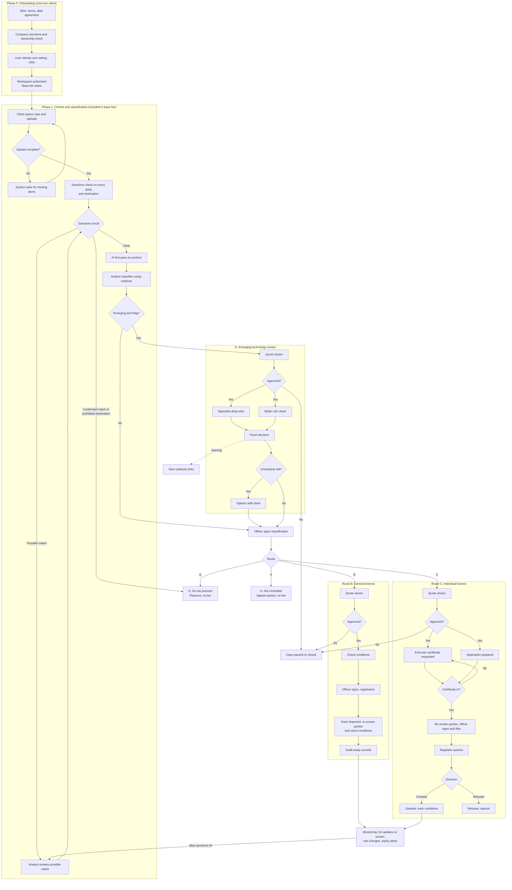
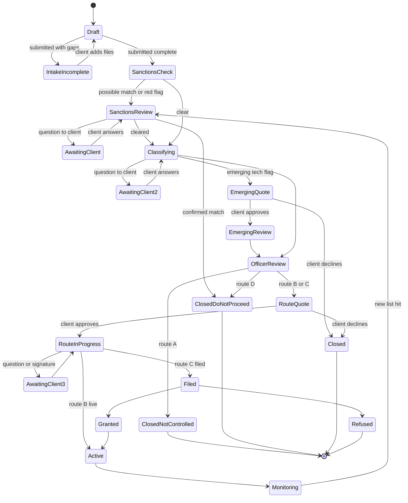

# Product design: export compliance desk (Stage 1)

Working name: **Cleared to Ship** (placeholder)
Prepared for: Ibad and the build team
Date: 31 October 2026
Scope: Stage 1 product only. UK exports, including the UK–Ukraine corridor.

---

## 1. What the product does

A client portal where a company uploads product and order information. Behind each case, an AI first pass, a trained analyst and a signing compliance officer return:

1. a sanctions check on every party,
2. a signed classification, and
3. where needed, the general licence or individual licence route, handled end to end.

**Design principles**

1. Classification and sanctions checks are included in the base fee. A price only appears when a case needs a licence or a specialist review.
2. No paid work starts until the client clicks **Approve** on a fixed quote.
3. AI suggests; people decide. Every outcome is signed by a compliance officer.
4. Nobody sees a case unless they are authorised for it (section 7).
5. We improve the file, never the facts. The product never offers to change a product description to get past a threshold.

---

## 2. Billing logic (product configuration)

Two plans. A client is on one plan; consultation is available on both.

| Item | Plan P: Pay per licence | Plan S: Subscription | When charged |
|---|---|---|---|
| Base fee | ~£250 / month | £500 to £1,500 / month, tiered by shipments per month | Monthly, from onboarding |
| Sanctions checks | Included | Included | Never charged separately |
| Classification | Included (fair-use limit, TBD) | Included (fair-use limit, TBD) | Never charged separately |
| Outcome A (not controlled) and D (do not proceed) | Included | Included | Never charged |
| Emerging technology review | £500 to £1,500 | £500 to £1,500 | Quote, approved before work |
| General licence setup | £250 to £500 one-off per general licence | £250 to £500 one-off per general licence | Quote, approved before work |
| Shipment under a general licence | ~£25 to £50 each | Included up to tier limit | Per shipment / included |
| Individual licence pack | £1k to £2.5k | Discounted | Quote, approved before work |
| Consultation | Hourly | Hourly | Quote, approved before work |

All prices are placeholders; store them as configuration, not code.

**Guarantee text (shown on every quote):** We guarantee the service, not the government decision: a complete, correct file signed by a qualified officer, reworked at no cost if rejected because of our error. The client remains the legal exporter.

---

## 3. Client action types

Every step tells the client exactly what they need to do. Use these labels as a chip on each step in the UI and as the `client_action` field in the backend.

| Label | Meaning | UI pattern |
|---|---|---|
| `UPLOAD` | Upload files | Drop zone with a required-file checklist |
| `DESCRIBE` | Answer in free text | Short text field with an example |
| `SELECT` | Pick from options | Dropdowns or cards |
| `ANSWER` | Answer a specific question from our team | Question card with reply box and optional file |
| `APPROVE` | Approve a quote or decision | Quote card with Approve / Ask a question |
| `SIGN` | Sign a declaration | E-signature with the full text shown |
| `WAIT` | Nothing needed, our team or the government is working | Status card with expected date |
| `NONE` | Case closed or informational | Summary card with downloads |

Only one client action is active per case at a time. If several are pending, show them as an ordered checklist.

---

## 4. End-to-end process

### 4.1 Flow diagram



### 4.2 Phase 0: Onboarding and authorisation (once per client)

| Step | Client action | What the client does | What the product / team does | Done when |
|---|---|---|---|---|
| 0.1 Account request | `DESCRIBE` | Company name, registration number, country, contact, what they export | Create pending organisation | Org record created |
| 0.2 Agreements | `SIGN` | Sign NDA, terms of service, data processing agreement | Countersign | All three signed |
| 0.3 Company sanctions and ownership check | `UPLOAD` | Certificate of incorporation; ownership structure (cap table or shareholder list) | Screen company, directors and owners above the ownership threshold against sanctions lists (section 5) | Check passed, or escalated |
| 0.4 User identity and vetting | `UPLOAD` + `SELECT` | Each user verifies identity and declares any existing security clearance level | Record vetting level per user; request evidence where a level is claimed | Each user verified |
| 0.5 Roles | `SELECT` | Client admin assigns roles: Admin, Member, Approver, Viewer | Check at least one Approver exists | Roles set |
| 0.6 Data handling level | `SELECT` | Confirm the highest sensitivity they will upload (Unclassified or OFFICIAL-SENSITIVE). SECRET is not accepted | Set org ceiling; assign internal staff with matching vetting | Ceiling set, team assigned |
| 0.7 Workspace live | `WAIT` → `NONE` | Nothing | Activate workspace, start base fee | Side panel shows "Authorised" |

No case can be opened until 0.7 is complete.

### 4.3 Phase 1: Checks and classification (included in base fee)

| Step | Client action | What the client does | What the product / team does | Target time |
|---|---|---|---|---|
| 1.1 Open case | `UPLOAD` + `SELECT` + `DESCRIBE` | Upload spec sheet, bill of materials, order or quote. Select destination, buyer, end user, consignee, any intermediaries (forwarder, agent), deadline. Describe end use in 1–3 sentences. Tag file sensitivity | Create case and ticket | 10–30 min |
| 1.2 Completeness check | `UPLOAD` (if needed) | Add anything flagged as missing | Check required fields and files | Instant |
| 1.3 Sanctions check | `WAIT`, or `ANSWER` on a possible match | Confirm details (address, registration number) if a possible match needs disambiguation | Full sanctions check, section 5 | Minutes; possible matches same day |
| 1.4 AI first pass | `WAIT` | Nothing | Extract parameters, suggest control list entries with confidence, compute US content share | Minutes |
| 1.5 Analyst classification | `ANSWER` (if needed) | Answer targeted questions (for example a missing frame rate) | Analyst applies rulebook entries | ≤1 working day |
| 1.6 Emerging tech check | `WAIT` | Nothing | Check triggers (section 4.4) | Same day |
| 1.7 Officer sign-off | `WAIT` | Nothing | Officer reviews sanctions result and classification, signs, decides route | ≤2 working days |

Sanctions runs **before** classification so that a prohibited party or destination stops the case early, before any classification work is done.

### 4.4 Sub-process E: Emerging technology review (before the route decision)

**Triggers (any one):** no rulebook match or low AI confidence; parameters near a control threshold; recently added or changed list entry; watch-list technology (AI and autonomy software, quantum, advanced chips, counter-drone, directed energy, advanced materials); intangible transfer (source code, model weights, design files, training data, remote access from abroad).

| Step | Client action | What the client does | What the product / team does | Target time |
|---|---|---|---|---|
| E1 Flag and quote | `APPROVE` | Read reason, extra time and fee; Approve or Ask a question | Show quote | Same day |
| E2 Technical deep-dive | `ANSWER` / `UPLOAD` (if needed) | Provide test data or extra technical detail if asked | Specialist reviews against thresholds | 2–5 working days |
| E3 Wider rule check | `WAIT` | Nothing | Analyst checks recent, national, end-use and US rules; technology transfer | Parallel with E2 |
| E4 Panel decision | `WAIT` | Nothing | Officer and specialist decide; record reasoning and remaining uncertainty | 1 working day |
| E5 Handle uncertainty | `SELECT` (if uncertainty remains) | Choose: treat as controlled / ask the regulator for a ruling where available / change the export | Explain options and consequences | Client decides |
| E6 Back to route decision | `WAIT` | Nothing | Continue to 1.7 | |
| E7 Learn | `NONE` | Nothing | New rulebook entry; 12-month rule-change watch | After case |

Note: the UK classification service has been paused since 12 Oct 2026, so "ask the regulator" may not be available for UK cases.

### 4.5 Route decision (what the client sees)

| Outcome | Client action | Portal message | Fee |
|---|---|---|---|
| **A. Not controlled** | `NONE` | "No licence needed. Sanctions check clear. Signed opinion and record saved." | None |
| **B. General licence** | `APPROVE` | "This can go under a general licence. Setup £X one-off. Shipments: included / £Y each." | Shown before work |
| **C. Individual licence** | `APPROVE` | "An individual licence is needed. Fixed fee £X. Our preparation 3–5 working days. Government decision usually ~4 weeks." | Shown before work |
| **B or C both possible** | `SELECT` + `APPROVE` | Side-by-side cards with price and trade-offs | Shown before work |
| **D. Do not proceed** | `NONE` | "We can't support this export." with reasons (sanctions match, prohibited destination or end use, diversion risk) | None |

### 4.6 Route B: General licence

| Step | Client action | What the client does | What the product / team does |
|---|---|---|---|
| B0 Quote | `APPROVE` | Approve setup fee and shipment pricing | Lock price |
| B1 Condition check | `ANSWER` (if needed) | Confirm any conditions (for example no onward transfer) | Analyst checks every condition |
| B2 Eligibility and registration | `SIGN` | Sign the declaration that they will meet the conditions | Officer signs eligibility; register or guide registration |
| B3 Each shipment | `UPLOAD` + `SELECT` | Upload shipment details (invoice, packing list, consignee) | **Re-screen all parties** and check conditions automatically; exceptions go to an analyst; record |
| B4 Ongoing records | `NONE` | Nothing | Audit-ready records; alerts if the general licence changes |

### 4.7 Route C: Individual licence

| Step | Client action | What the client does | What the product / team does | Target time |
|---|---|---|---|---|
| C0 Quote | `APPROVE` | Approve fixed fee | Lock price | |
| C1 End-user certificate | `WAIT` (forward buyer link if needed) | Forward the buyer link if the buyer is not yet in the portal | Send certificate template to the buyer immediately | Day 0 |
| C2 Application prepared | `ANSWER` (if needed) | Answer questions on quantities, values, end use | Analyst prepares application and documents | Day 1–2 |
| C3 Certificate received | `WAIT` | Nothing (buyer uploads) | Check certificate; **screen any new party named on it** | Day 3–4 typical |
| C4 Sign and file | `SIGN` | Sign the applicant declaration | **Re-screen all parties**; officer reviews, signs and files | Day 4–5 |
| C5 Regulator queries | `ANSWER` (if needed) | Provide information the regulator asks for | Respond within 48h | As needed |
| C6 Decision | `WAIT` | Nothing | Track status | ~4 weeks (government) |
| C7 Granted | `NONE` | Download licence pack | Track conditions, quantities, expiry; renewal alerts | |
| C8 Refused | `SELECT` | Choose next step (appeal, amend, stop) | Explain reasons and options | |

### 4.8 Monitoring (after any route)

| Event | Client action | What happens |
|---|---|---|
| Sanctions list update hits a party on an open case or active licence | `WAIT` or `ANSWER` | Case or shipments paused; analyst reviews; client told what to do |
| Rule change affecting a product | `NONE` or `APPROVE` | Alert; if re-classification is needed, a new case opens |
| Facts change (design, buyer, destination) | `DESCRIBE` | New case or re-quote; price never changes without approval |
| Licence nearing expiry | `APPROVE` | Renewal quote |

---

## 5. Sanctions check (detail)

### 5.1 When it runs

| Moment | What is screened |
|---|---|
| Onboarding (0.3) | Client company, directors, owners above the ownership threshold |
| Case opened (1.3) | All parties and the destination |
| End-user certificate received (C3) | Any new party named on it |
| Before filing (C4) | All parties again |
| Every shipment (B3) | All parties on that shipment |
| Daily, while a case or licence is active | All parties, against the latest list versions |

### 5.2 What is checked

| Check | Detail |
|---|---|
| **Parties** | Buyer, end user, consignee, intermediate consignees, freight forwarder, agent, and any bank named on the order |
| **Lists** | UK consolidated sanctions list; UK trade sanctions measures; EU consolidated list; UN Security Council list; US lists that apply when US content or US persons are involved (Treasury SDN list, Commerce Entity List and related lists) |
| **Ownership** | Whether a party is owned or controlled by a listed person, using ownership data where available (threshold configurable) |
| **Destination** | Country and region restrictions; prohibited destinations stop the case |
| **Goods** | Whether the items fall under sanctions goods restrictions (for example Russia-related trade restrictions and high-priority diversion items) |
| **Diversion red flags** | Unusual routing, a distributor in a country next to a sanctioned state, mismatch between end use and buyer business, refusal to provide end-user details, payment from an unrelated third party |
| **Contract clause** | For in-scope goods, confirm the contract contains a "no re-export to Russia" clause; offer template text if missing |

### 5.3 Results and what the product does

| Result | Meaning | Product behaviour | Client action |
|---|---|---|---|
| **Clear** | No match, no red flags | Continue to classification | `WAIT` |
| **Possible match** | Name similar to a listed party | Analyst reviews; may ask the client for identifiers | `ANSWER` (if asked) |
| **Red flag** | Diversion indicator, no list match | Analyst reviews; officer decides whether to continue, ask questions or stop | `ANSWER` (if asked) |
| **Confirmed match or prohibited destination** | Listed party, owned by a listed party, or prohibited destination | Case goes to **D. Do not proceed**; reasons recorded; client told plainly | `NONE` |
| **Sanctions licence may be possible** | A sanctions authorisation could permit the deal | Officer flags; offered as a separate quoted route (consultation first) | `APPROVE` (if they want to proceed) |

### 5.4 Build notes

- Use a screening data provider through an API rather than building list ingestion; store the list version and timestamp with every result.
- Fuzzy name matching with a tunable threshold; every possible match needs a human decision, recorded with reason.
- Re-screening jobs run on list updates and daily; any new hit creates a task and pauses affected shipments.
- Sanctions results appear in the side panel (section 7.5) and in the signed case pack.

---

## 6. Case state machine



Each state maps to exactly one `client_action` shown in the UI.

---

## 7. Authorisation design (including security clearance)

### 7.1 Principles

1. **Need-to-know by default.** Access is granted per case, not per organisation.
2. **Four checks before any file is shown:** organisation authorised, role allows it, user vetting meets the case requirement, user is assigned to the case.
3. **Location matters.** Showing controlled technology to someone abroad can itself be an export. Staff and partners outside the UK (for example a Kyiv law firm) see only what their case permits, and never controlled technical files unless an export authorisation covers it.
4. **SECRET is out of scope.** Uploads tagged SECRET are blocked.
5. **Everything is logged.** Every view, download, edit, approval, signature and sanctions decision.

### 7.2 Roles

| Role | Side | Can do |
|---|---|---|
| Client Admin | Client | Manage users and roles, see all org cases, approve quotes |
| Client Member | Client | Open cases, upload, answer questions |
| Client Approver | Client | Approve quotes, sign declarations |
| Client Viewer | Client | Read-only |
| Buyer (external) | Buyer | Upload end-user certificate via a single-use link; sees only the certificate request |
| Analyst | Internal | Work assigned cases, review sanctions matches, ask client questions, prepare packs |
| Compliance Officer | Internal | Review and sign sanctions decisions, classifications and filings; decide routes |
| Specialist | Internal | Emerging technology reviews on assigned cases |
| Partner (e.g. Kyiv law firm) | External | Assigned case sections only; no controlled technical files without an authorisation flag |
| Ops Admin | Internal | Onboarding, billing, user management; **no access to case files** |

### 7.3 Permission matrix

| Action | C-Admin | C-Member | C-Approver | C-Viewer | Analyst | Officer | Specialist | Partner | Ops Admin |
|---|---|---|---|---|---|---|---|---|---|
| Open case | ✓ | ✓ | ✓ | | | | | | |
| Upload files | ✓ | ✓ | ✓ | | ✓ | ✓ | ✓ | limited | |
| View technical files | ✓ | ✓ | ✓ | ✓ | assigned | assigned | assigned | flag only | |
| View sanctions results | ✓ | ✓ | ✓ | ✓ | assigned | assigned | | | |
| Clear a possible sanctions match | | | | | propose | ✓ | | | |
| Ask client a question | | | | | ✓ | ✓ | ✓ | | |
| Approve quote | ✓ | | ✓ | | | | | | |
| Sign client declaration | ✓ | | ✓ | | | | | | |
| Sign classification / filing | | | | | | ✓ | | | |
| Manage users | ✓ (own org) | | | | | | | | ✓ |
| See audit log | ✓ (own org) | | | | | ✓ | | | ✓ |

### 7.4 Clearance and sensitivity attributes

| Object | Attribute | Values |
|---|---|---|
| Organisation | `onboarding_status` | pending, agreements_signed, checks_passed, authorised, suspended |
| Organisation | `sanctions_status` | clear, under_review, blocked |
| Organisation | `data_ceiling` | unclassified, official_sensitive |
| User | `identity_verified` | true / false |
| User | `vetting_level` | none, baseline, sc, dv |
| User | `location` | country of access |
| Case | `sensitivity` | unclassified, official_sensitive, controlled_technology |
| Case | `sanctions_status` | pending, clear, under_review, blocked |
| File | `sensitivity` | inherited from case, can be raised per file |
| Assignment | `case_id`, `user_id`, `role` | need-to-know list |

**Access rule (pseudo-code)**

```
can_view(user, file):
  org(file).onboarding_status == "authorised"
  and org(file).sanctions_status != "blocked"
  and role_allows(user.role, "view", file.type)
  and user.identity_verified
  and vetting_rank(user.vetting_level) >= required_vetting(file.sensitivity)
  and user in assignments(file.case_id)
  and location_allowed(user.location, file.sensitivity, case.export_authorisations)
```

`required_vetting`: unclassified → none; official_sensitive → baseline; controlled_technology → baseline plus case-specific approval by the officer. Values are configurable; confirm real requirements with our security adviser.

### 7.5 Side panel: "Authorisation and status"

A persistent right-hand panel on every case screen. It answers: **Are we allowed to work on this? Who can see it? Are the parties clear? What happens next?**

```
┌───────────────────────────────────────┐
│ AUTHORISATION                         │
│ Organisation        ✅ Authorised     │
│   NDA               ✅ Signed 12 Oct  │
│   Contract / DPA    ✅ Signed 12 Oct  │
│   Company checks    ✅ Passed         │
│   Data ceiling      OFFICIAL-SENSITIVE│
│                                       │
│ This case                             │
│   Sensitivity       Controlled tech   │
│   Hosting           UK region         │
│   Access            4 people  [view]  │
│     You (Approver)  Baseline ✅       │
│     Analyst         Baseline ✅       │
│     Officer         SC ✅             │
│     Specialist      SC ✅             │
│   Partner access    None              │
├───────────────────────────────────────┤
│ SANCTIONS                             │
│   Buyer             ✅ Clear          │
│   End user          ✅ Clear          │
│   Consignee         ⚠ Possible match │
│   Forwarder         ✅ Clear          │
│   Destination       ✅ Not restricted │
│   Lists checked     UK, EU, UN, US    │
│   Last screened     31 Oct 09:12      │
├───────────────────────────────────────┤
│ YOUR NEXT ACTION                      │
│   ▶ ANSWER  Confirm consignee's       │
│     registration number               │
│     [Reply]                           │
├───────────────────────────────────────┤
│ CASE STATUS                           │
│   ● Sanctions check       in review   │
│   ○ Classification        -           │
│   ○ Route                 -           │
├───────────────────────────────────────┤
│ FEES ON THIS CASE                     │
│   Sanctions checks  Included          │
│   Classification    Included          │
├───────────────────────────────────────┤
│ AUDIT  Last 5 events          [all]   │
└───────────────────────────────────────┘
```

Behaviour rules:
- Any red item in Authorisation or Sanctions **locks** the case (no uploads, no work) and shows the fix or the reason.
- A possible match shows ⚠ until an officer clears or confirms it; the officer's decision and reason are shown on hover.
- The access list shows each person's role and vetting level as a badge; client admins can request removal of an internal person.
- "Next action" always shows exactly one client action label (section 3).
- Fees show "Included" for sanctions checks, classification and outcomes A and D; quoted items show "awaiting approval" until approved.

---

## 8. Data model

| Entity | Key fields |
|---|---|
| Organisation | id, name, reg_no, country, plan (P / S), plan_tier, onboarding_status, sanctions_status, data_ceiling |
| User | id, org_id, name, email, role, identity_verified, vetting_level, location |
| Agreement | id, org_id, type (nda / terms / dpa), signed_by, signed_at, file_id |
| Product | id, org_id, name, version, description, parameters (json), classification_id |
| Party | id, name, type (buyer / end_user / consignee / intermediary / forwarder / agent / bank), country, identifiers (json), owners (json) |
| ScreeningResult | id, party_id, case_id, lists_checked, list_versions, result (clear / possible / red_flag / match), reviewed_by, decision, reason, screened_at |
| Case | id, org_id, product_ids, party_ids, destination, end_use, deadline, sensitivity, sanctions_status, state, route, emerging_flag |
| File | id, case_id, type (spec / bom / order / euc / licence / other), sensitivity, storage_region, hash |
| Classification | id, case_id, list_entries, reasoning, rulebook_refs, confidence, signed_by, signed_at |
| RulebookEntry | id, title, list_entries, decision_logic, examples, author, version, updated_at |
| Quote | id, case_id, item (emerging / general_setup / individual / consultation / sanctions_licence), amount, status (shown / approved / declined), approved_by, approved_at |
| Licence | id, case_id, type (general / individual / open_individual), reference, conditions, quantity_limits, expiry |
| Shipment | id, licence_id, party_ids, items, value, screening_result_ids, check_result, recorded_at |
| Question | id, case_id, from_user, to_role, text, answer, status |
| Assignment | id, case_id, user_id, role |
| AuditEvent | id, actor_id, action, object, object_id, timestamp, ip, location |

---

## 9. Technical guardrails

1. **Hosting:** UK region; all storage and processing in-region.
2. **AI:** model hosted in the same region under a no-training, no-retention agreement. Never send controlled technical files to an offshore AI service.
3. **Encryption:** at rest and in transit; per-org keys if feasible.
4. **Files:** virus scan on upload; hash stored; watermark downloads with user and time.
5. **Authentication:** SSO or email plus mandatory MFA; session location checks.
6. **Audit log:** append-only, exportable for a regulator visit.
7. **Screening:** list versions stored with every result; daily re-screening job.
8. **Security baseline:** aim for Cyber Essentials Plus before the first paying client.
9. **No SECRET material:** blocked at upload.

---

## 10. Screens

| Screen | For | Main elements |
|---|---|---|
| Onboarding wizard | Client admin | Steps 0.1 to 0.7 with progress bar |
| Case list | Client | Cases with state, next action chip, deadline |
| New case | Client member | Upload zone, party fields, selects, end-use text, sensitivity tag |
| Case detail | Client | Main timeline + side panel (section 7.5) |
| Quote card | Client approver | Price, scope, time, guarantee text, Approve / Ask a question |
| Buyer certificate page | External buyer | Single-use link, template download, upload |
| Desk queue | Analyst, officer | Tickets by state and target time, "assigned to me" |
| Sanctions review | Analyst, officer | Party details, candidate matches side by side, clear / confirm with reason |
| Ticket workspace | Analyst | File viewer, AI suggestions, rulebook search, question composer |
| Officer review | Officer | Sanctions summary, classification reasoning, pack, sign button |
| Rulebook editor | Officer | Entries, versions, linked cases |
| Shipment log | Client, analyst | Shipments under each licence, screening and condition results |
| Admin | Ops admin | Orgs, users, billing; no case content |

---

## 11. Build phases (Stage 1)

### 11.1 Hackathon demo
Clickable flow for one illustrative case (Skyline Drones, 200 flight controllers with thermal cameras to a Ukrainian buyer):
- Onboarding already ✅ in the side panel
- New case with upload, parties and selects
- Sanctions result: one possible match on the consignee, cleared by the officer
- AI first pass (mocked) and analyst ticket with two rulebook entries
- Officer sign-off
- Route C quote card with Approve
- Side panel visible throughout

### 11.2 Pilot version (8–12 weeks)
- Onboarding with e-signature and identity checks
- Case intake, UK-region file storage, audit log
- Sanctions screening via a data provider API, with review screen
- Analyst and officer queue; manual classification, AI assist optional
- Quotes and approvals; invoicing
- Rulebook v1 (top 20 entries for drones, cameras, radios, encryption)

### 11.3 Version 1
- AI extraction and suggestions with confidence scores
- General licence route with per-shipment re-screening and condition checks
- Emerging technology sub-process and specialist role
- Buyer portal for end-user certificates
- Daily re-screening, rule-change alerts, licence expiry tracking
- Partner (Kyiv) restricted access with location rules

---

## 12. Open questions for the team

1. Fair-use limit on included classifications per plan: show it up front or keep it in the contract?
2. Emerging tech review: charge the fee even when the result is "not controlled", or absorb it?
3. Which vetting levels do internal roles need for the first clients? Confirm with a security adviser.
4. Can we file as an agent on the UK licensing system, or does the client file with our prepared pack?
5. Which screening data provider, and which ownership data source?
6. Legal review of terms: liability cap, scope wording ("regulatory compliance service, not legal advice"), insurance.

---

## 13. Glossary

| Term | Meaning |
|---|---|
| Sanctions check | Screening parties, destination and goods against sanctions lists and diversion red flags |
| Classification | Deciding whether an item is on a control list, and which entry |
| General licence | Pre-approved licence an exporter registers to use, with conditions (UK: open general export licence) |
| Individual licence | Licence for a specific item, buyer and destination (UK: standard individual export licence) |
| Open individual licence | Individual licence covering multiple shipments |
| End-user certificate | Document from the buyer confirming end use and no re-export |
| ECJU | UK Export Control Joint Unit, which issues licences |
| Rulebook | Internal library of classification and route decisions, written by officers from real cases |
| Vetting level | Personnel security check level (baseline, SC, DV) |
